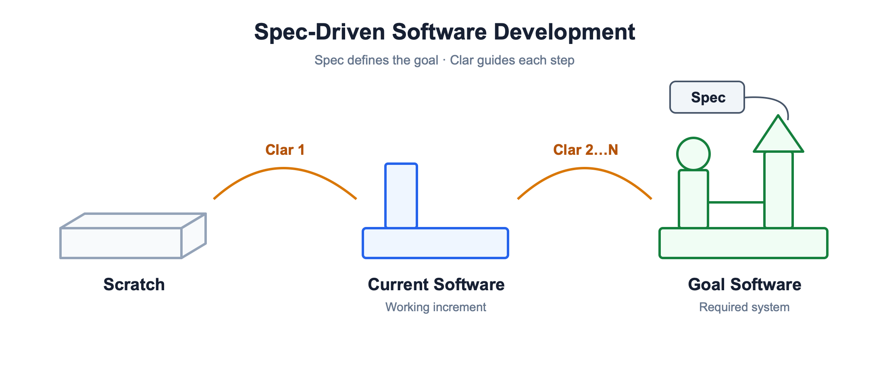
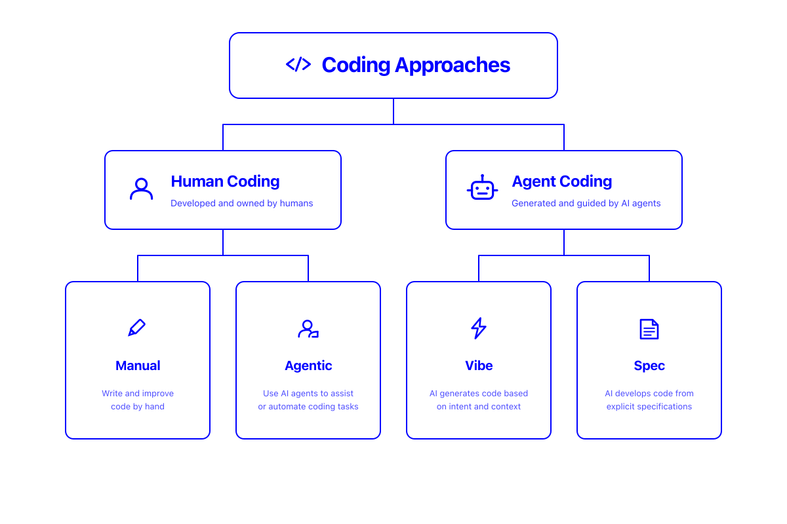

# Spec-Driven Software Development

**Define the goal. Clarify the steps. Build toward it.**

AI-SpecCoding is a working repository for developing software with human engineers and AI agents from explicit specifications. It brings together a development workflow, visual explanations, and a SwiftUI macOS application as a practical example.

The central idea is simple: **Spec defines what the software should become. Clar defines how to develop toward it.**

## The development model

Software progresses from **Scratch → Current Software → Goal Software**. Each clarification guides an implementation step toward the result defined by the specification.

| Layer | Question it answers | Responsibility |
| --- | --- | --- |
| **Spec** | What should the software be? | Define intended behavior, structure, constraints, and requirements. |
| **Clar** | How do we develop toward it? | Translate part of the specification into ordered implementation guidance. |
| **Implementation** | What exists today? | Realize the specification through code and other generated artifacts. |

[Source/Specs](Source/Specs) is the authoritative source of truth for output under `Source/`. [Source/Clars](Source/Clars) provides development guidance subordinate to those specifications.

A clarification may describe implementation details, examples, and sequencing. It must not introduce requirements absent from the specification. When implementation or clarification conflicts with the specification, correct the conflicting artifact.

If the intended software changes, change the specification intentionally, then update the affected clarifications and implementation.

## Explore the examples

### Coding approaches

A visual comparison of human and agent coding, covering manual, agent-assisted, vibe, and specification-driven approaches.

Follow one example from definition to output:

1. [Specification](Source/Specs/Coding%20Models.md) — the diagram’s content, layout, typography, and visual rules.
2. [Clarification](Source/Clars/1000-Generate%20Coding%20Models.md) — ordered instructions for constructing it.
3. [HTML implementation](Source/Coding%20Models/index.html) — the diagram built with inline SVG.
4. [Exported image](Coding-Models.png) — the resulting visual artifact.

To view the HTML version, open `index.html` in `Source/Coding Models` in a browser.

### DeskUtils

[DeskUtils](Source/Desk%20Utils) is a macOS desktop utilities application built with Swift, SwiftUI, and Swift Concurrency. Its specification defines two utilities:

- **Software Manager:** inspect installed applications and packages from Homebrew, pip, and npm.
- **Folder Manager:** inspect folder disk usage, with resumable scans and size-based navigation.

The utilities inspect information and reveal locations in Finder. Installation, uninstallation, and deletion are outside their specified scope.

The application follows a layered architecture: **Views → ViewModels → Managers → Trackers**, with shared value models.

Start with the [application specification](Source/Specs/Desk%20Utils.md) and [UI specification](Source/Specs/UI.md). To work with the implementation, open [DeskUtils.xcodeproj](Source/Desk%20Utils/DeskUtils.xcodeproj) in Xcode on macOS. The project targets macOS 14.0 or later.

## Use the workflow

1. **Define the desired result.** Write or refine the applicable specification under `Source/Specs`. Make behavior and constraints explicit enough to review.
2. **Clarify the next increment.** Add implementation guidance under `Source/Clars`, grounded in the specification.
3. **Follow dependency order.** Name clarifications using `<Order>-<Clarification-name>`. Lower-order steps establish the foundation for later steps.
4. **Implement the increment.** Read the relevant specification, clarification, and any local `Specs.md` before changing content.
5. **Review against the specification.** Check that the output satisfies the intended behavior without adding conflicting assumptions. Distinguish static review from compilation, tests, and runtime verification.
6. **Repeat toward the goal.** Use the current implementation as the starting point for the next step while keeping the specification authoritative.

The same process applies when starting from scratch or extending existing software.

## Repository guide

| Location | Contents |
| --- | --- |
| [Source/Specs](Source/Specs) | Authoritative specifications for the examples. |
| [Source/Clars](Source/Clars) | Ordered development clarifications. |
| [Source/Coding Models](Source/Coding%20Models) | HTML and inline SVG coding-approaches diagram. |
| [Source/Desk Utils](Source/Desk%20Utils) | DeskUtils source code and Xcode project. |
| [Spec-Driven-Development.png](Spec-Driven-Development.png) | Overview of the development model. |
| [Coding-Models.png](Coding-Models.png) | Coding-approaches illustration. |
| [AGENTS.md](AGENTS.md), [CLAUDE.md](CLAUDE.md), [GEMINI.md](GEMINI.md) | Repository instructions for coding agents. |
